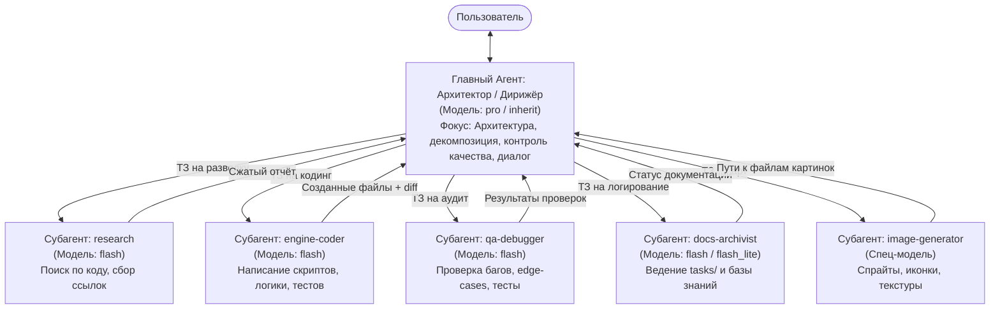

# Руководство по оркестрации субагентов (SUBAGENTS_ORCHESTRATION.md)

> **Назначение:** Практический гайд для Главного Агента-Архитектора (Argon) по делегированию задач, разделению обязанностей и сохранению чистоты главного контекстного окна с использованием экосистемы субагентов Antigravity.

---

## 1. Концепция: Архитектор vs Исполнители

Главная причина деградации рассуждений AI в больших проектах — **засорение контекста рутиной**. Когда модель читает десятки исходников, выводит длинные логи терминала и пишет сотни строк шаблонного кода, контекстное окно заполняется «шумом», и агент теряет нить архитектуры.



---

## 2. Градация задач по уровням примитивности

| Уровень сложности | Доля делегирования | Подходящая модель | Примеры задач | Исполнитель |
| :--- | :---: | :---: | :--- | :--- |
| **Уровень 1: Примитивная рутина** | **100%** | `flash_lite` | Составление списков названий, форматирование JSON/YAML/CSV, проверка орфографии, шаблонные DTO/структуры данных. | `routine-worker` |
| **Уровень 2: Стандартная разработка** | **100%** | `flash` | Разведка кодовой базы, написание контроллеров, компонентов, юнит-тестов, оформление точечных логов `docs/tasks/task_XX.md`. | `research`, `engine-coder`, `docs-archivist` |
| **Уровень 3: Глубокий аудит и ревью** | **80%** | `flash` / `pro` | Поиск утечек памяти, профилирование, стресс-тесты, проверка граничных условий. | `qa-debugger` |
| **Уровень 4: Системная архитектура** | **0% (Лично)** | `pro` / `inherit` | Принятие ключевых архитектурных решений, математика физики, рефакторинг ядра движка, коммуникация с пользователем. | **Главный Агент (Argon)** |

---

## 3. Матрица специализированных ролей субагентов

### 1. `research` (Шпион / Исследователь)
- **Цель:** Изучить проект, найти нужные классы, методы или конфиги без засорения главного окна вызовами чтения файлов.
- **Инструменты:** Только чтение (`read_file`, grep, поиск). Сеть отключена для безопасности.
- **Что возвращает:** Краткую выжимку с номерами строк и путями к файлам.

### 2. `engine-coder` (Разработчик фич)
- **Цель:** Реализовать конкретный скрипт, интерфейс или компонент по точному ТЗ.
- **Инструменты:** Создание и редактирование файлов (`write_file`, `edit_file`), запуск тестов.
- **Что возвращает:** Список созданных/изменённых файлов, ключевые методы и статус компиляции.

### 3. `qa-debugger` (Тестировщик и Ревьюер)
- **Цель:** Найти слабые места в коде, проверить обработку null/граничных значений, запустить тесты или симуляцию.
- **Инструменты:** Чтение файлов, запуск команд (`run_command`), редактирование тестов.
- **Что возвращает:** Список найденных дефектов и рекомендации по их устранению.

### 4. `docs-archivist` (Архивариус базы знаний)
- **Цель:** Создать точечный лог в `docs/tasks/task_XX_<name>.md`, обновить `docs/session.md`, а в конце этапа упаковать всё в `docs/stages/` и `docs/knowledge_base/`.
- **Инструменты:** `write_file`, `edit_file`.
- **Что возвращает:** Подтверждение обновления документации со ссылками.

### 5. `image-generator` (Художник / Дизайнер)
- **Цель:** Генерация и редактирование игровых спрайтов, UI-иконок, концептов и фонов.
- **Инструменты:** Инструменты генерации изображений.
- **Что возвращает:** Абсолютные пути к сохранённым `.png` файлам.

---

## 4. Выбор модели (`Model`)

При вызове `invoke_subagent` передавай параметр `Model`:
- **`flash_lite`**:
  * Сверхбыстрая скорость ответа (1–3 секунды).
  * Минимальное потребление квоты.
  * Идеальна для списков предметов, словарей локализации, черновых конфигов, тривиального форматирования.
- **`flash` (Рекомендуется для 90% задач)**:
  * Баланс высокой скорости и отличного понимания кода.
  * Написание 95% игровых скриптов, логики, тестов и документации.
- **`pro` / `inherit`**:
  * Максимальная глубина рассуждений.
  * Применяется для сложных алгоритмов (поиск пути A*, процедурная генерация, сложные математические шейдеры, комплексный рефакторинг ядра).

---

## 5. Изоляция рабочих папок (`Workspace`)

В параметре `Workspace` инструмента `invoke_subagent` доступны три режима:

1. **`Workspace: "inherit"` (По умолчанию)**  
   Субагент работает прямо в текущей папке проекта. Подходит для последовательных задач и документирования.
2. **`Workspace: "share"` (Рекомендуется для параллельного кодинга)**  
   Создаёт отдельную рабочую директорию, использующую общее хранилище репозитория (аналог `git worktree`). Субагент может менять код в своей ветке, не затрагивая файлы, с которыми прямо сейчас работает пользователь или другой субагент в IDE.
3. **`Workspace: "branch"`**  
   Создаёт полностью изолированный клон/ветку. Идеально для экспериментов и рискованных рефакторингов.

---

## 6. Примеры практических вызовов API

### Пример 1: Быстрая разведка кодовой базы через встроенный `research` (flash)
```json
{
  "TypeName": "research",
  "Role": "Codebase Investigator",
  "Model": "flash",
  "Prompt": "Найди все скрипты в проекте, где обрабатывается ввод прыжка игрока. Укажи пути к файлам и конкретные строки, где применяется сила прыжка или считывается кнопка ввода. Верни только краткую сводку с путями и номерами строк."
}
```

---

### Пример 2: Определение специализированного разработчика (`engine-coder`)
```json
{
  "Name": "engine-coder",
  "Description": "Специалист по написанию чистого кода модульных механик для выбранного движка.",
  "SystemPrompt": "Ты — старший разработчик игровых механик. Твоя задача — писать чистый, модульный, производительный код, снабжённый комментариями к публичным методам. Ты создаёшь файлы по переданному ТЗ, строго соблюдаешь код-стайл и не используешь тяжелые вычисления в циклах обновления кадров без необходимости.",
  "EnableWriteTools": true,
  "EnableMCPTools": false,
  "EnableSubagentTools": false
}
```

---

### Пример 3: Запуск кодера на реализацию механики в изолированной ветке
```json
{
  "TypeName": "engine-coder",
  "Role": "Inventory System Developer",
  "Model": "flash",
  "Workspace": "share",
  "Prompt": "Создай систему предметов инвентаря:\n1. Создай интерфейс IItem и базовый класс BaseItem (название, вес, иконка, метод Use()).\n2. Создай контроллер InventoryController с добавлением, удалением и проверкой лимита веса.\n3. Напиши юнит-тесты на проверку добавления и переполнения.\nПосле создания файлов отправь отчёт со списком созданных путей и кратким описанием API."
}
```

---

### Пример 4: Запуск архивариуса для оформления точечного лога задачи
```json
{
  "TypeName": "self",
  "Role": "Docs Archivist",
  "Model": "flash",
  "Workspace": "inherit",
  "Prompt": "Оформи отчет по закрытой задаче 'Реализация механики отскока pogo':\n1. Создай файл docs/tasks/task_04_pogo_bounce.md по шаблону docs/tasks/task_template.md.\n2. Опиши: Что сделано (изменен PlayerCombat.cs), Как сделано (Down-slash удар при коллизии с врагом придает игроку импульс Vector2.up * bounceForce), Зачем сделано (core-механика исследования метроидвании).\n3. Обнови docs/session.md, отметив пункт чек-листа со ссылкой на task_04_pogo_bounce.md.\nОтправь подтверждение."
}
```

---

## 7. Золотые правила формулирования промпта для субагента

Чтобы субагент сработал с первой попытки без лишних итераций, следуй правилу **«4 Ч»**:

1. **Чёткий контекст:**  
   Укажи, в каких именно папках лежат связанные файлы, какие интерфейсы использовать. Не заставляй его угадывать структуру проекта.
2. **Чёткие границы задачи:**  
   Один субагент — одна атомарная задача. «Напиши класс прыжка» — хорошо. «Сделай всю игру» — плохо.
3. **Чёткий формат ответа:**  
   В конце промпта явно напиши:  
   *«В итоговом сообщении через send_message верни строго: 1) Список созданных/изменённых файлов; 2) Описание публичных методов; 3) Статус тестов.»*
4. **Чёткая изоляция:**  
   Если задача не требует изменения кода проекта (например, поиск или аудит), используй агентов с правами только для чтения или изолированный `Workspace`.
