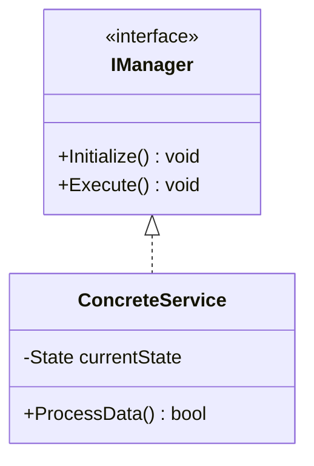

# База знаний: `[Название подсистемы / механики / гайда]`

> **Категория:** `[Архитектура / Игровая механика / Сеть / UI / Оптимизация]`  
> **Последнее обновление:** `[ГГГГ-ММ-ДД]`  
> **Статус:** 🟢 Актуально

---

## 1. Обзор и назначение
`[Дайте исчерпывающее описание механики или системы: какую проблему она решает, как взаимодействует с игроком или внешними системами]`

---

## 2. Архитектура и структура классов

### Диаграмма взаимодействия


### Ключевые компоненты:
1. **`CoreClass`** (`path/to/CoreClass.ext`):  
   Главный координатор системы. Отвечает за жизненный цикл.
2. **`DataModel`** (`path/to/DataModel.ext`):  
   Хранилище состояния без игровой логики.
3. **`ViewComponent`** (`path/to/ViewComponent.ext`):  
   Отображение состояния и подписка на события модели.

---

## 3. Публичный API и контракт вызовов

```csharp
/// <summary>
/// Основной метод взаимодействия с системой
/// </summary>
/// <param name="targetId">Идентификатор цели</param>
/// <param name="amount">Количество передаваемых единиц</param>
/// <returns>True, если действие выполнено успешно</returns>
public bool PerformAction(string targetId, int amount);
```

### События (Events / Signals):
- `OnActionStarted(ActionContext context)` — вызывается в момент инициации;
- `OnActionCompleted(ActionResult result)` — вызывается при успешном завершении.

---

## 4. Конфигурация и тюнинг параметров
| Параметр | Тип | Диапазон по умолчанию | Влияние на систему |
| :--- | :---: | :---: | :--- |
| `Cooldown` | `float` | `0.5 — 2.0s` | Задержка перед повторным срабатыванием |
| `MaxCapacity` | `int` | `1 — 99` | Предельный размер хранилища |

---

## 5. Типичные ошибки и грабли (Troubleshooting / Pitfalls)

> [!WARNING]
> **Частая ошибка №1:** `[Например: Не забывать отписываться от событий в OnDestroy / OnDisable, иначе возникнут утечки памяти]`.

> [!TIP]
> **Совет по оптимизации:** `[Например: Не вызывать GetComponent в Update(); кэшируйте ссылки в Awake()]`.
