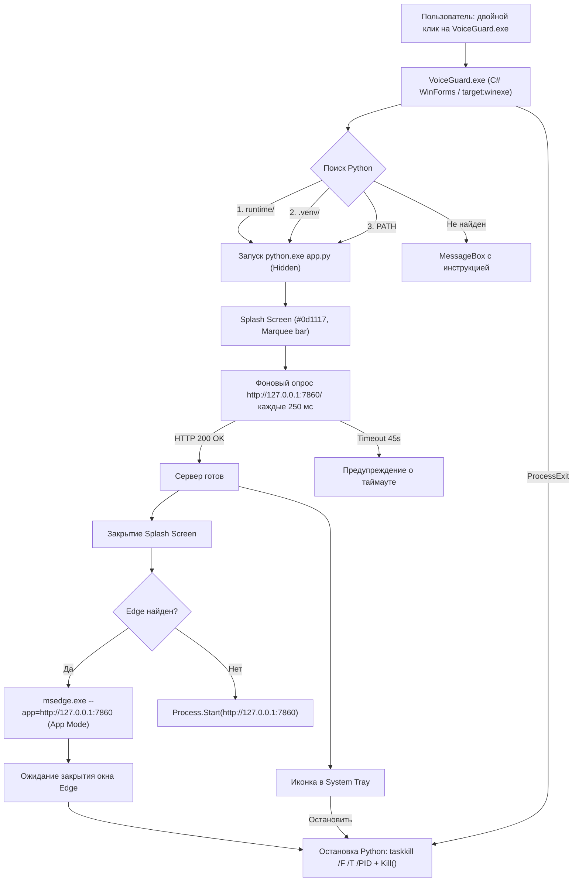

# Лог задачи: `[09] Автономный нативный лаунчер VoiceGuard.exe и портативная упаковка` (`task_09_standalone_launcher.md`)

> **Дата создания:** 2026-11-05  
> **Исполнитель:** `engine-coder` (Argon Subagent)  
> **Статус:** ✅ Завершена  
> **Связанная сессия:** [`docs/session.md`](../session.md)

---

## 1. Что было сделано
- Создана директория инструментов лаунчера `tools/launcher/`.
- Разработан генератор многослойной Windows-иконки `tools/launcher/make_icon.py` на базе Pillow (размеры: 256x256, 128x128, 64x64, 48x48, 32x32, 16x16) со стилизованным щитом и аудиоволной в стиле Frosted Glass / VoiceGuard Cyan.
- Сгенерирован файл иконки `tools/launcher/app.ico` (93 КБ).
- Разработано нативное C# WinForms приложение `tools/launcher/VoiceGuardLauncher.cs` без консольного окна:
  - Автоматический поиск среды Python в порядке приоритета: `runtime\python.exe` → `.venv\Scripts\python.exe` → системный Python из `PATH`.
  - Бесшумный запуск веб-сервера `python.exe app.py` с сокрытием окна.
  - Премиальный Splash Screen в темных тонах (`#0d1117`) с индикатором загрузки `Marquee ProgressBar` и перетаскиванием формы мышью.
  - Асинхронный опрос `http://127.0.0.1:7860/` каждые 250 мс с таймаутом 45 секунд.
  - Запуск веб-интерфейса в режиме нативного приложения через Microsoft Edge (`--app="http://127.0.0.1:7860"` с изолированным пользовательским профилем) и автоматическим fallback на системный браузер.
  - Полноценная интеграция с System Tray (NotifyIcon) для мониторинга и быстрого завершения.
  - Гарантированное завершение дерева процессов Python при выходе (через `taskkill /F /T` и перехват `ProcessExit`), исключающее появление зомби-процессов и зависание порта 7860.
- Скомпилирован нативный исполняемый файл `VoiceGuard.exe` в корень репозитория с помощью стандартного `csc.exe` .NET Framework 4.8.
- Разработан скрипт упаковки портативного дистрибутива `tools/package_portable.ps1`, формирующий самодостаточный ZIP-архив с документацией `README_PORTABLE.txt`.
- Обновлен `.gitignore` для исключения директории дистрибутивов `dist/`.

### Список затронутых файлов:
- 🟢 `[Создан]` [`tools/launcher/make_icon.py`](file:///c:/Users/gumar/Documents/voiceguard/tools/launcher/make_icon.py) — Скрипт генерации многослойной иконки VoiceGuard.
- 🟢 `[Создан]` [`tools/launcher/app.ico`](file:///c:/Users/gumar/Documents/voiceguard/tools/launcher/app.ico) — Высококачественная иконка приложения.
- 🟢 `[Создан]` [`tools/launcher/VoiceGuardLauncher.cs`](file:///c:/Users/gumar/Documents/voiceguard/tools/launcher/VoiceGuardLauncher.cs) — Исходный код нативного C# лаунчера.
- 🟢 `[Создан]` [`VoiceGuard.exe`](file:///c:/Users/gumar/Documents/voiceguard/VoiceGuard.exe) — Готовый исполняемый файл лаунчера (110 КБ).
- 🟢 `[Создан]` [`tools/package_portable.ps1`](file:///c:/Users/gumar/Documents/voiceguard/tools/package_portable.ps1) — PowerShell-скрипт создания портативного ZIP-пакета.
- 🟡 `[Изменён]` [`.gitignore`](file:///c:/Users/gumar/Documents/voiceguard/.gitignore) — Добавлена директория `dist/`.
- 🟡 `[Изменён]` [`docs/session.md`](file:///c:/Users/gumar/Documents/voiceguard/docs/session.md) — Добавлена выполненная задача 08/09.

---

## 2. Как это реализовано (Технические детали)

### Архитектурная схема работы лаунчера



### Ключевые фрагменты кода:

#### Изолированный App Mode для Edge:
```csharp
string profileDir = Path.Combine(
    Environment.GetFolderPath(Environment.SpecialFolder.LocalApplicationData),
    @"VoiceGuard\EdgeAppProfile"
);

string args = string.Format(
    "--app=\"{0}\" --window-size=1280,860 --user-data-dir=\"{1}\" --no-first-run",
    targetUrl,
    profileDir
);

ProcessStartInfo psi = new ProcessStartInfo(edgePath, args) { UseShellExecute = false };
_edgeProcess = Process.Start(psi);
```

#### Безопасное завершение дерева процессов:
```csharp
if (_pythonProcess != null && !_pythonProcess.HasExited)
{
    ProcessStartInfo killPsi = new ProcessStartInfo(
        "taskkill", 
        string.Format("/F /T /PID {0}", _pythonProcess.Id)
    )
    {
        CreateNoWindow = true,
        UseShellExecute = false,
        WindowStyle = ProcessWindowStyle.Hidden
    };
    using (Process kp = Process.Start(killPsi))
    {
        if (kp != null) kp.WaitForExit(3000);
    }
    if (!_pythonProcess.HasExited) _pythonProcess.Kill();
}
```

---

## 3. Зачем это было сделано так (Обоснование решений)
1. **Чистый C# под встроенный .NET Framework 4.8 (`csc.exe`):**  
   Не требует установки .NET SDK, Visual Studio или сборщиков MSBuild/NuGet. Компилируется встроенным системным компилятором Windows за доли секунды.
2. **Edge App Mode (`--app`):**  
   Превращает Gradio веб-приложение в полноценное нативное настольное окно без адресной строки, вкладок и панелей браузера, обеспечивая опыт дорогого desktop-софта.
3. **Изолированный `--user-data-dir`:**  
   Гарантирует, что процесс Edge стартует как отдельный независимый инстанс, позволяя лаунчеру точно отслеживать закрытие окна через `WaitForExit()`.
4. **Трей-иконка (NotifyIcon) + `taskkill /F /T`:**  
   Решает классическую проблему питоновских веб-приложений под Windows, когда сервер остаётся висеть в памяти и блокирует порт 7860.

---

## 4. Потенциальная ценность для базы знаний
- [x] 💡 **Универсальный паттерн:** Нативный C# 1-клик лаунчер для любых локальных AI/ML веб-сервисов (Gradio, Streamlit, FastAPI) с Edge App Mode и очисткой процессов. Рекомендуется перенести в `docs/knowledge_base/standalone_desktop_launcher.md`.
- [x] 🛠️ **Инструмент:** Скрипт сборки дистрибутива `tools/package_portable.ps1` сохранен в каталоге `tools/`.
